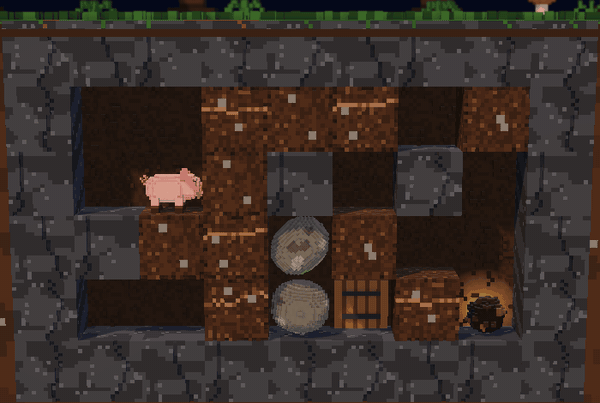

# Dig Pig

A turn-based browser puzzle game in the spirit of *Boulder Dash* (1984). A truffle pig digs through a voxel forest floor. It has to eat every truffle, then reach the door, without bringing the stones down on its head.

Every key press is one turn, and nothing moves until you do. 10 levels, in English or French, on desktop and on phones held sideways. No install, no account, no server.

**[Play in your browser](https://arimet.github.io/dig-pig/)**



## How to Play

1. Dig through the soil and eat every truffle. The counter at the top shows how many are left.
2. Once the last truffle is eaten, the door opens. Walk into it to finish the level.
3. If a stone crushes the pig, the game shows it, then takes the fatal move back.

A level earns 3 stars without a single undo, restart or crush, 2 with up to three, and 1 after that. The **Solution** button replays a winning run from the start, and the level then earns no star.

| Action | Keyboard | Touch |
| --- | --- | --- |
| Walk, dig, eat or push sideways | ← → or A / D (Q / D on AZERTY) | Swipe left or right |
| Dig down | ↓ or S | Swipe down |
| Wait a turn | Space | **Wait** button |
| Undo | U or Backspace | **Undo** button |
| Restart | R | **Restart** button |

There is no key to go up: pigs don't climb.

## Rules

- The pig walks, digs soil, eats truffles and pushes a stone sideways when the tile behind it is empty. It hops onto a one-tile ledge when there is room above its head.
- With nothing under its trotters, the pig drops, unhurt whatever the height. It eats a truffle it lands on.
- Stones and truffles fall one tile per turn. One resting on another stone or a truffle rolls off towards a free side, left first.
- If the only thing in the way of a roll is the pig, the stone tips over onto its back.
- A stone that only starts to fall right above the pig settles on its back. A stone already falling crushes it. A truffle that lands on the pig is eaten.
- While anything is falling, the pig included, turns go by on their own. Keys wait until everything has come to rest.
- The door is set in the back wall. The pig and the stones pass in front of it, and a stone resting in the doorway blocks the way out until it is pushed off.
- When no way to the door is left, a note says so and offers to undo or restart.

## Levels

| # | Name | Hint |
| --- | --- | --- |
| 1 | First Snuffle | The pig drops when nothing holds it up |
| 2 | Pebble Pusher | Pushing a stone |
| 3 | Tumble | A stone rolls off another one |
| 4 | Roots | One-tile steps are the only way back up |
| 5 | The Burrow | A fallen stone never goes back up |
| 6 | Under the Stump | One truffle, the door at the other end |
| 7 | Scree | Drop the stones where they no longer get in the way |
| 8 | The Warren | No stones: the order of your descents |
| 9 | The Truffle Bed | Almost every path ends in a dead end |
| 10 | The Rockslide | Almost no room for mistakes |

Levels open in order. They were grown by a generator and checked by a solver: each one is solvable, and the later ones have more ways to get stuck.

## Run It Locally

You need Node.js 22 or later.

```bash
npm install
npm run dev
```

| Command | What it does |
| --- | --- |
| `npm run dev` | Starts the game on http://localhost:5173 |
| `npm test` | Runs the simulation, solver, controller and level tests |
| `npm run build` | Type-checks and builds the static site in `dist/` |
| `npm run levels` | Solves every level and prints its difficulty: decisions, traps, dead ends |

URL options: `?fps` shows a frame counter, and `?quality=high` or `?quality=low` forces a renderer tier. In development, `?level=7` opens any level, and `gallery.html` shows the voxel models.

## Make a Level

Each level is one JSON file in `src/levels/`.

```json
{
  "id": 2,
  "name": { "fr": "Pousse-caillou", "en": "Pebble Pusher" },
  "idea": { "fr": "Tu peux pousser une pierre…", "en": "You can push a stone sideways when the tile behind it is empty." },
  "grid": ["########", "#P  *# #", "#.o .X.#", "##. .# #", "# .# . #", "########"]
}
```

- `grid` characters: `P` the pig, `X` the door, `*` a truffle, `o` a stone, `.` soil, `#` bedrock, a space for an empty tile. The border must be bedrock.
- The door must stand on bedrock, and nothing may be falling when the level opens.
- `need` is optional: the truffles to eat before the door opens. It defaults to all of them.
- `idea` is the hint shown when the level opens.

Then run `npm run levels -- --write`. It solves every level and stores a shortest solution in `solution`, which the **Solution** button replays. The tests check that each level opens at rest, has its door on bedrock, and that its stored solution wins.

`scripts/gen.ts` grows new levels by simulated annealing towards a band of difficulty, for example:

```bash
npx tsx scripts/gen.ts --w 8 --h 6 --truffles 2 --actions 20-25 --traps 8-11 --seed 1 --out /tmp/level.json
```

## How It Works

| Folder | Role |
| --- | --- |
| `src/sim` | Level parser, deterministic turn simulation, solver. No DOM, no Three.js. |
| `src/game` | Turns key presses into animated turns. Keeps every state, so undo, restart and the solution replay walk the history. |
| `src/render` | Three.js scene. Every model is built from voxels in code: there is no asset file. |
| `src/ui` | Screens, saved progress, translations. |
| `src/audio` | Sound effects synthesised with Web Audio. |
| `src/levels` | One JSON file per level, plus the list of worlds. |

The solver explores decisions, not key presses. While the pig wanders without changing the forest, it counts as one decision, so only digs, pushes, eats and falls branch the search. A full search of the hardest level takes under 100 ms. The game runs the same search from the current position to tell when the door can no longer be reached.

## Translations

Interface texts live in `src/ui/i18n.ts`, one dictionary per language. TypeScript refuses a dictionary with a missing key. Level and world names carry one entry per language.

The game picks French for French browsers and English otherwise. The button in the top corner of the title and level screens switches language and remembers the choice.

## Deploy

`.github/workflows/deploy.yml` tests, builds and publishes `dist/` to GitHub Pages on every push to `main`. In the repository settings, set Pages to *Source: GitHub Actions*. The build uses relative URLs, so it works under any path.

## Contributing

Issues and pull requests are welcome, new levels included. Run `npm test` before opening a pull request.

## Credits

Inspired by *Boulder Dash* by Peter Liepa and Chris Gray (First Star Software, 1984). This project is not affiliated with First Star Software. Levels, models and sounds are original. The font is [Pixelify Sans](https://fonts.google.com/specimen/Pixelify+Sans) (SIL Open Font License).

## License

[MIT](LICENSE)
